<div align="center">
  
</div>

### Olá! Eu sou o João Henrique ☕

Engenheiro de formação, nerd por opção.

Trabalho onde negócio e tecnologia se encontram: tiro ideias do papel, organizo o caos em processos e transformo processos em software que roda sozinho. Passei pelo chão de fábrica de uma multinacional e pelo zero-a-um de uma startup, e nos dois lugares fiz a mesma coisa: entender como o trabalho acontece de verdade, medir, automatizar o que dá e colocar o time para entregar em ciclos curtos.

```text
FICHA DO PERSONAGEM
─────────────────────────────────────────────────────
Classe ........... Gestor de projetos de tecnologia
Especialidade .... processos → automação → produto
Habilidades ...... Scrum · Kanban · BPM · Lean · Power BI
Combustível ...... café
Em treinamento ... Lean Six Sigma Green Belt
```

### 📜 Quest log

**🏰 Origox** · Cofundador · Gestão de Tecnologia e Projetos · `2025 – atual`
- Desenvolvi e lancei sozinho a plataforma, da definição de escopo e arquitetura até a entrada em operação.
- Depois do lançamento, liderei o time de desenvolvimento com Scrum e Kanban no Notion, coordenando integrações com APIs, infraestrutura externa e pipelines de dados.
- Estruturei gestão de riscos, regras operacionais e segurança, com indicadores e painéis para apoiar decisões.

**🏭 Kingspan Isoeste** · Supervisor de Processos · `2021 – 2025`
- Idealizei e implantei softwares internos que automatizaram etapas críticas da operação e reduziram retrabalho.
- Mapeei processos-chave de ponta a ponta (BPM) e mantive dashboards em Power BI usados pela gestão.
- Implantei soluções digitais para requisitos da ISO 9001 e acompanhei auditorias.

### 🎒 Inventário



<sub>**Gestão:** Scrum · Kanban · Backlog · Roadmap de produto · Stakeholders · Riscos · Liderança de equipes &nbsp;—&nbsp; **Processos:** BPM · Lean · ISO 9001 · Melhoria contínua &nbsp;—&nbsp; **Dados e automação:** Power BI · KPIs · APIs · Pipelines de dados · Python</sub>

### 🏆 Conquistas desbloqueadas

- Business Process Management — FGV
- Liderança e Motivação — FGV
- Gestão Financeira para Pequenas e Médias Empresas
- Lean Six Sigma Green Belt — *carregando...*

### 🧪 Side quest atual

**[tupios](https://github.com/devcriptojhs-ux/tupios)**: e se uma IA tivesse acesso a tudo na sua máquina, inclusive o kernel? Um sistema operacional AI-native sobre NixOS.

### ☕ Movido a café

Cada quadradinho é uma contribuição. Cada contribuição, um café.

<picture>
  <source media="(prefers-color-scheme: dark)" srcset="https://raw.githubusercontent.com/devcriptojhs-ux/devcriptojhs-ux/output/coffee-contrib-dark.svg">
  <source media="(prefers-color-scheme: light)" srcset="https://raw.githubusercontent.com/devcriptojhs-ux/devcriptojhs-ux/output/coffee-contrib.svg">
  
</picture>

<br><br>

<div align="center">
  <a href="https://www.linkedin.com/in/joaohenrique-sampaio-defreitas-3905a9159"></a>
</div>
